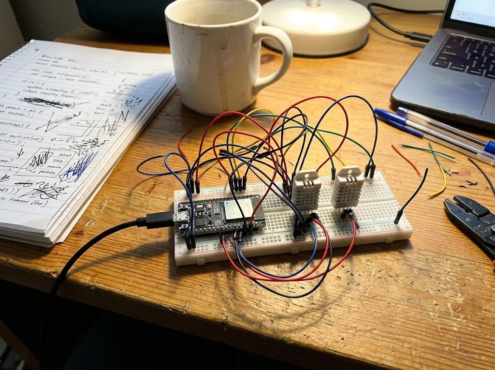
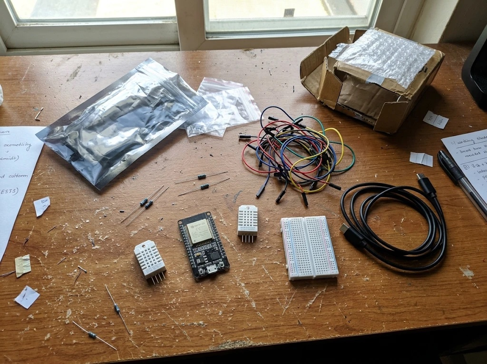
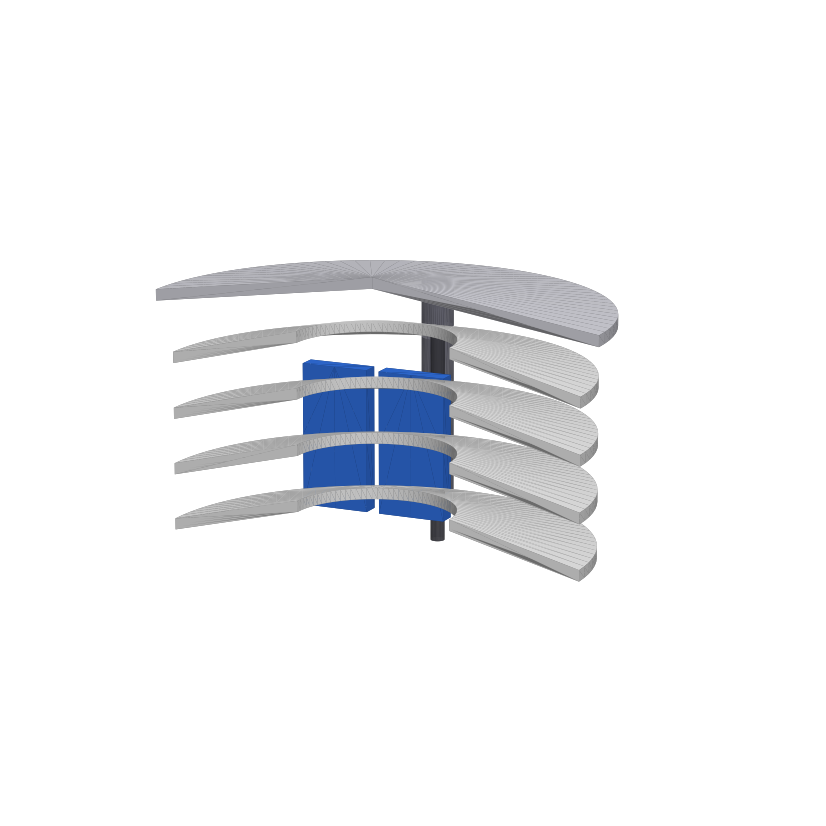

# Frost Early-Warning Array

Course project for ELT.123 Electronic Components and Circuits, Ala-Too International University.
Author: Nurislam (@nur1sla8).

## About

Night frost can kill crops, and it often happens when the air looks fine in the evening. This project is a
small sensor node on an ESP32-S3 that measures temperature and humidity with two DHT22 sensors,
calculates the dew point, and gives a warning level (NORMAL, WATCH, WARNING, CRITICAL, FROST) when the
temperature falls toward freezing at night. Nodes can send data over ESP-NOW to a second ESP32 (the
gateway), and a web page shows everything live.

Current state: the prototype is built on a breadboard, the code compiles and the core logic is tested on a PC.
I only have one ESP32 so far, so the gateway code is written but not tested, and tests outside on real
nights are still to do.

## Photos

Breadboard prototype: ESP32 board and two DHT22 sensors, powered over USB.



Parts used: ESP32 board, 2 x DHT22, breadboard, pull-up resistors, jumper wires, USB cable.



Short bench demo (10 s, download and watch): [docs/videos/IMG_6533.MP4](docs/videos/IMG_6533.MP4)

## 3D model

For outdoor use the sensors need a radiation shield, so they do not read the sun or the cold night sky
instead of the air. I designed a simple one: 4 conical plates and a roof, stacked on 3 M3 rods with
spacers. The air goes through the gaps and the centre hole, the rain runs off the cones.



Files are in `cad/`: `shield_plate.stl` (print 4), `shield_cap.stl` (print 1), `shield_spacer.stl` (print
12) and `shield_assembly.stl` for the whole thing. The sizes are parameters in `cad/make_shield.py`
(needs `trimesh`, `manifold3d`, `numpy`, `matplotlib`). Not printed yet, so the fit is not tested.

## Hardware

- ESP32-S3 dev board (a second ESP32 for the gateway)
- 2 x DHT22 (AM2302)
- 2 x resistor 4.7k to 10k, as pull-ups on the DATA lines
- a radiation shield for outdoor use (white plates or a louvred box)

Wiring:

| DHT22 pin | Sensor 1 | Sensor 2 |
|---|---|---|
| 1 VCC | GPIO6 | GPIO7 |
| 2 DATA | GPIO4 + pull-up to VCC | GPIO5 + pull-up to VCC |
| 3 NC | not connected | not connected |
| 4 GND | GND | GND |

The sensors are powered from GPIO pins so the code can power-cycle a sensor that hangs. If you want to
use 3V3 directly, set `DHT*_POWER_PIN -1` in `firmware/frost_node/config.h`.

## How it works

1. Each DHT22 is read and checked (value range, sudden spikes, stuck output).
2. If both sensors agree (within 1 °C and 5 % RH) the average is used. If they disagree, the colder one is
   used. If only one works, that one is used.
3. The dew point is calculated with the Magnus formula:

   ```
   g  = ln(RH/100) + 17.62*T / (243.12 + T)
   Td = 243.12*g / (17.62 - g)
   ```

4. The warning level is picked from the 10-minute average temperature between 18:00 and 09:00, with 0.5 °C
   hysteresis so it does not flicker:

   | Level | Rule |
   |---|---|
   | WATCH | T <= 4 °C |
   | WARNING | T <= 3 °C |
   | CRITICAL | T <= 2 °C |
   | FROST | T <= 0 °C |

5. The node prints a line to Serial every minute, saves a log to flash, and sends a packet over ESP-NOW to
   the gateway. `tools/dashboard.html` shows the data in the browser.

The thresholds come from an analysis of the Bishkek weather station archive (2005-2025). Method and
tables are in [docs/RESEARCH.md](docs/RESEARCH.md).

## Build and run

1. Install Arduino IDE 2 and the "esp32 by Espressif Systems" board package.
2. In Preferences set the sketchbook location to the `firmware/` folder of this repo.
3. Install the libraries "DHT sensor library" (Adafruit) and "Adafruit Unified Sensor".
4. Open `firmware/frost_node/frost_node.ino`. Select board "ESP32S3 Dev Module", turn on "USB CDC On Boot"
   and pick a partition scheme with SPIFFS (for example "Default 4MB with spiffs").
5. Upload, then open the Serial Monitor at 115200 baud. Type `HELP` to see the commands.

To log data on a PC and see the dashboard:

```
python3 tools/serial_logger.py <serial port> data/logs/night_01.csv
```

Then open `tools/dashboard.html` in Chrome or Edge and press "Connect ESP32" (or "Open CSV log").

Tests that need no hardware:

```
make -C firmware/host_tests test
```

This runs 50 unit checks of the core code (`firmware/libraries/FrostCore`).

## Results

What works:

- Two-sensor reading, dew point and warning levels (tested on PC and compiled for ESP32-S3).
- Replay of real archive data through the C++ code gives the same result as the Python reference.
- Prototype is assembled and the dashboard shows live values from the board.

What was found in the archive study (1993 frost-season nights, 583 frost events): the cooling rate and
the dew-point rate did not make warnings better than just using the temperature and the time of night.
A high dew point slows cooling, but only as a level, not as a rate. That is why the rates are only shown
as extra info and do not change the warning level.

What is not done:

- Tests on real hardware outside (bench and night measurements). Test plan is in
  [docs/TEST_PLAN.md](docs/TEST_PLAN.md).
- Gateway is untested because I have only one ESP32.

## Limitations

- It measures air temperature only, not leaf or soil temperature.
- No cloud or wind sensor, so it cannot tell a clear calm night from cold wind.
- DHT22 humidity is not accurate near 100 %, so small T - Td values (below about 1 °C) are not reliable.
- The thresholds are from a city station with 3-hour data, so they should be rechecked with local data.

## Repository

```
analysis/   Python code for the archive study
cad/        3D model of the radiation shield (STL + generator script)
data/       archive data and replay files
docs/       research, test plan, images, video
firmware/   node and gateway sketches, FrostCore library, PC tests
results/    tables and figures from the study
tools/      serial logger, replay tools, dashboard.html
```

Weather data: Meteostat (CC BY-NC 4.0).
