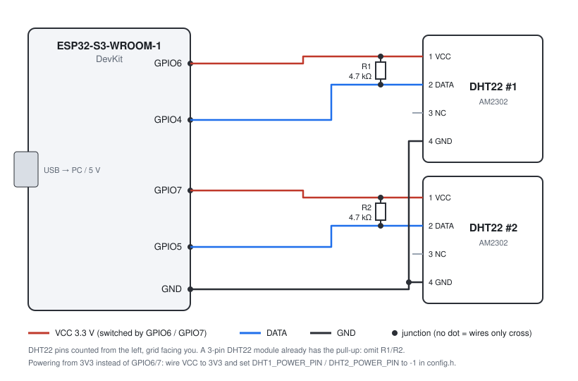
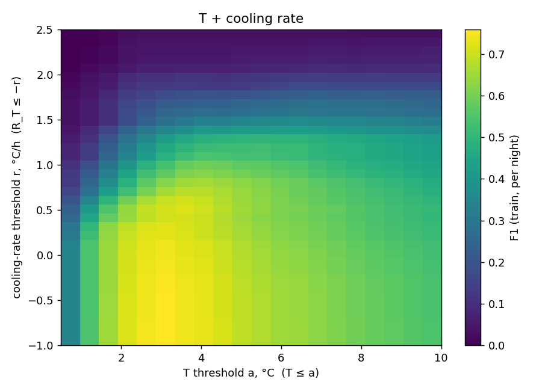

# Frost Early-Warning Array

Low-cost ESP32-S3 nodes with two DHT22 sensors that compute the dew point on board, track air-temperature
and dew-point trends, and raise graded warnings of night-time frost. Telemetry goes over ESP-NOW to a
gateway and a browser dashboard.

**Course:** ELT.123 Electronic Components and Circuits, Ala-Too International University
**Author:** Nurislam ([@nur1sla8](https://github.com/nur1sla8))
**Status:**

- archive study done;
- firmware core tested on PC;
- ESP32-S3 build compiles;
- **hardware tests pending.**

## Research question

> What rate of temperature drop and dew-point convergence reliably triggers early warnings?

**Short answer (Bishkek station 2005–2025, 1993 frost-season nights, 583 frost events, 3-hourly data):**

- Neither the cooling rate nor the rate of dew-point convergence improved warnings beyond the
  temperature level and the time of night.
- Requiring a cooling rate of 0.5–1.5 °C/h on top of "T ≤ 3 °C" removed 23–82 % of the correctly
  warned frost nights, with no real gain in precision.
- The dew point helps as a **level**: a high Td slows cooling. It does not help as a rate.
- Sub-hourly rates, which our sensors measure, are still an open hypothesis for local data.

Full method, tables and limits: [`docs/RESEARCH.md`](docs/RESEARCH.md).

## Architecture

```
 Sensor node (ESP32-S3)                                  Gateway (ESP32)            PC / phone
┌─────────────────────────────────────────┐  ESP-NOW   ┌───────────────────┐ USB  ┌────────────────────┐
│ DHT22 #1 ─┐   QC: range, spike, stuck    │  star,     │ CRC + dedupe      │────▶ │ serial_logger.py   │
│ DHT22 #2 ─┴─▶ fusion (agree / colder)    │  1 frame/  │ loss from seq gaps│      │ dashboard.html     │
│               Magnus Td, frost point     │  min ────▶ │ OFFLINE after 3 m │      │ (Web Serial / CSV) │
│               trends R_T, R_D (1 h, 3 h) │ ◀──────────│ time beacon / min │      │ threshold_study.py │
│               levels + hysteresis        │  beacon    └───────────────────┘      └────────────────────┘
│ LittleFS CSV log (2-file ring), NVS cfg  │
│ Serial: D-rows, commands, REPLAY mode    │
└─────────────────────────────────────────┘
```

**ESP-NOW is used as a star, not a mesh.**

- ESP-NOW has no routing, so every node must be in radio range of the gateway.
- Frames are 54 bytes and carry CRC-16, node id, boot id and sequence number.
- Unicast to the gateway MAC gives a link-layer ACK; the default broadcast does not.
- If range ever needs relaying, add a repeater node that forwards frames, or switch to ESP-WIFI-MESH.

**Only one ESP32 is available now.** Therefore:

- the gateway sketch is written but untested;
- the node works stand-alone over USB;
- the dashboard reads the node directly.

## Hardware

| Part | Qty | Note |
|---|---|---|
| ESP32-S3-WROOM-1 dev board | 1 (+1 for the gateway) | Check the module marking (N8, N16R8 …) for flash size |
| DHT22 / AM2302 | 2 | ±0.5 °C, ±2–5 % RH, 0.1 resolution, ≥ 2 s between reads |
| Resistor 4.7–10 kΩ | 2 | DATA pull-up to the sensor's VCC. Not needed if the module already has one; use 4.7 kΩ for cables longer than about 1 m at 3.3 V |
| Radiation shield | 1 | Stacked white plates or a louvred box. Never leave sensors in direct sun or open to the night sky |
| Optional: DS18B20 probe | 1 | Independent air reference, or a sensor at plant height |

### Wiring (ESP32-S3)

| DHT22 pin | Sensor #1 | Sensor #2 |
|---|---|---|
| 1 VCC | GPIO6 (switched power) | GPIO7 (switched power) |
| 2 DATA | GPIO4 + pull-up to VCC | GPIO5 + pull-up to VCC |
| 3 NC | – | – |
| 4 GND | GND | GND |



**Pins:**

- Powering each sensor from a GPIO lets the firmware power-cycle a hung sensor. To use 3V3 directly,
  set `DHT*_POWER_PIN -1` in `firmware/frost_node/config.h`.
- GPIO4–7 are free on the S3. Avoid the strapping pins 0, 3, 45 and 46, the USB pins 19 and 20, and
  GPIO 26–37 (flash/PSRAM).

**Placement:**

- Shielded and ventilated.
- Both sensors side by side for the first nights. This gives a relative calibration and lets the
  firmware catch a failing sensor.
- Later, optionally, at two heights to see the night-time inversion.
- Two identical DHT22s can share the same bias. Their agreement shows consistency, not accuracy.

## Build and flash (Arduino IDE)

1. Install Arduino IDE 2 and **esp32 by Espressif Systems** in the Boards Manager.
2. *File → Preferences → Sketchbook location* = the `firmware/` folder of this repo. The IDE then finds
   `firmware/libraries/FrostCore`.
3. Install the libraries **DHT sensor library** (Adafruit) and **Adafruit Unified Sensor**.
4. Open `firmware/frost_node/frost_node.ino` and set the board:
   - Board **ESP32S3 Dev Module**;
   - **USB CDC On Boot: Enabled** if you use the native USB port;
   - Flash Size to match your module;
   - Partition Scheme with SPIFFS, e.g. *Default 4MB with spiffs*. The log uses LittleFS on that partition.
5. Upload, then open the Serial Monitor at 115200 baud with line ending *Newline*. Type `HELP`.

**Build status.** Compiled with arduino-cli 1.4.1, esp32 core 3.3.12 (ESP-IDF 5.5), DHT sensor
library 1.4.7 and Adafruit Unified Sensor 1.1.15, with zero warnings from project code:

| Sketch | Board | Flash used | RAM used |
|---|---|---|---|
| node | ESP32-S3 | 946 KB (72 %) | 55 KB |
| gateway | ESP32-S3 | 872 KB (66 %) | – |
| gateway | ESP32 | 888 KB (67 %) | – |

The sketches have **not been run on hardware yet**. The core 2.x code paths (IDF 4.4) are not compiled.

Command-line build:

```bash
arduino-cli compile --fqbn "esp32:esp32:esp32s3:CDCOnBoot=cdc,PartitionScheme=default" \
  --library firmware/libraries/FrostCore firmware/frost_node
arduino-cli upload  --fqbn "esp32:esp32:esp32s3:CDCOnBoot=cdc,PartitionScheme=default" \
  -p /dev/cu.usbmodemXXXX firmware/frost_node
```

### Node commands (Serial)

| Command | Purpose |
|---|---|
| `STATUS` | Sensors, ESP-NOW counters, level, log size |
| `SHOW` | Show the current configuration |
| `SET key=value`, `SAVE` | Change thresholds, offsets or node id, and keep them in NVS |
| `TIME <unix>` | Set the clock. Without a clock the level is evaluated at any hour and flagged |
| `MODE REPLAY`, then `R,ts,t1,rh1,ok1,t2,rh2,ok2,time_valid` | Hardware-in-the-loop replay |
| `DUMP`, `CLEARLOG` | Print or clear the flash log |

## Run

```bash
# log a node (sets its clock from the PC)
python3 tools/serial_logger.py /dev/cu.usbmodemXXXX data/logs/night_01.csv
# dashboard: open tools/dashboard.html in Chrome/Edge → "Connect ESP32" (Web Serial) or "Open CSV log"
```

## Tests that run without hardware

```bash
make -C firmware/host_tests test                       # 50 unit checks of FrostCore
python3 -I tools/make_replay.py data/raw/meteostat_38353_hourly.csv.gz data/replay/bishkek_test40.csv
firmware/host_tests/replay_cli < data/replay/bishkek_test40.csv > data/replay/cpp_out.csv
python3 -I tools/compare_replay.py data/replay/bishkek_test40.csv data/replay/cpp_out.csv   # → RESULT: MATCH
```

Bench and field tests: [`docs/TEST_PLAN.md`](docs/TEST_PLAN.md).

## How it works

**Psychrometrics** (Magnus, Sonntag 1990 coefficients, as in WMO-No. 8):

```
γ  = ln(RH/100) + 17.62·T / (243.12 + T)        Td = 243.12·γ / (17.62 − γ)       (over water)
frost point: same vapour pressure, inverted with 22.46 / 272.62                    (over ice)
D  = T − Td        R_T = dT/dt,  R_D = dD/dt   (least-squares slope over 1 h and 3 h, NaN if < 60 % covered)
```

- RH is clamped to 1–100 %.
- Against Murphy & Koop (2005), the formula is accurate to ≤ 0.05 °C between −20 and 30 °C. That is far
  below the sensor error.
- DHT22 error propagates to T − Td as ±0.3 °C (±2 % RH) to ±0.8 °C (±5 % RH). Gaps smaller than about
  1 °C are therefore not resolvable in absolute terms.

**Sensor QC and fusion.** Each reading goes through:

1. range check;
2. spike rejection (> 1 °C/min or > 10 %/min), accepted after 3 repeats as a real step;
3. stuck-output detection.

Then:

- both sensors agree (≤ 1 °C and ≤ 5 % RH): the mean is used, quality GOOD;
- they disagree: the colder sensor is used, DEGRADED;
- only one is valid: that one is used, DEGRADED;
- none is valid: level UNKNOWN.

**Warning levels (initial mode).** Decided on the 10-min mean T in the 18:00–09:00 local window, with
0.5 °C hysteresis. Thresholds come from the archive study; recall and false-alarm ratio are on the
test years 2020–2025:

| Level | Rule | Recall | False-alarm ratio |
|---|---|---|---|
| WATCH | T ≤ 4.0 °C | 0.94 | 0.44 |
| WARNING | T ≤ 3.0 °C | 0.90 | 0.34 |
| CRITICAL | T ≤ 2.0 °C | 0.75 | 0.29 |
| FROST | T ≤ 0 °C | detection, not a forecast | – |

- Rates and dew point are reported as context flags and do not change the level, because the data did
  not support it.
- **Calibrated mode:** the same study is rerun on local logs with an independent frost reference.
  The new thresholds are loaded with `SET` and `calibrated=1`.

## Data format

Node log and Serial `D,` rows (one per minute on Serial; every 5 min and at each level change in flash):

```
unix_ts,node_id,boot_id,seq,uptime_s,t1,rh1,ok1,t2,rh2,ok2,t,rh,td,tf,d,t_smooth,rt_1h,rd_1h,rt_3h,
quality,level,level_name,flags,send_fail_streak,calibrated,time_valid
```

- `quality`: 0 = GOOD, 1 = DEGRADED, 2 = BAD.
- `level`: 0 = UNKNOWN, 1 = NORMAL, 2 = WATCH, 3 = WARNING, 4 = CRITICAL, 5 = FROST.
- `flags`: the bit field in `firmware/libraries/FrostCore/src/engine.h`.
- Flash holds 2 × 256 KB ≈ 16 days at 5-min logging, and survives reboots.

## Results

### Archive study (done)

Bishkek SYNOP, frost season 2005–2025. Thresholds were chosen on 2005–2014; the figures below are
for the test years 2020–2025 (492 nights, 126 frost events). Details: [`docs/RESEARCH.md`](docs/RESEARCH.md).

| Rule | Precision | Recall | F1 |
|---|---|---|---|
| T ≤ 3 °C | 0.66 | 0.90 | 0.76 |
| T ≤ 3 °C and cooling ≥ 0.5 °C/h | 0.64 | 0.70 | 0.67 |
| T ≤ 3 °C and cooling ≥ 1.0 °C/h | 0.69 | 0.39 | 0.50 |
| Best gap + convergence rule (T − Td, R_D) | 0.27 | 0.91 | 0.41 |



Lead time:

- the median is 3 h at 3-hourly resolution;
- 43 % of the warned events had 6 h or more;
- the true lead is up to 3 h shorter, because the observations are 3 h apart.

### Firmware verification (done, on PC)

- 50/50 FrostCore unit tests pass.
- The C++ engine and the Python reference agree on 36 040 replay steps (40 archive nights with injected
  sensor faults).
- The node and gateway sketches compile for ESP32-S3.

### Hardware, bench and field measurements (not done yet)

| Test ([`docs/TEST_PLAN.md`](docs/TEST_PLAN.md)) | Result |
|---|---|
| Replay on the ESP32-S3 matches the reference | [to be measured] |
| DHT22 #1 vs #2 co-location offset (°C, % RH) | [to be measured] |
| RH over saturated NaCl (expected ≈ 75 %) | [to be measured] |
| Step response time constant τ (s) | [to be measured] |
| Cold-box run: WATCH → WARNING → CRITICAL → FROST | [to be measured] |
| Nights logged / frost events / warnings issued, with lead time | [to be measured] |

## Analysis Summary

**Goals achieved:**

- Dew point computed on board with a formula checked against a reference (≤ 0.05 °C error).
- Warning thresholds derived from 20 years of station data instead of guessed numbers, with
  an event-based evaluation split by year.
- A tested answer to the research question for 3-hourly data: the cooling rate and dew-point
  convergence did not improve warnings beyond the temperature level.
- Firmware that handles sensor failures, spikes, a stuck sensor, a missing clock and reboots, with
  a flash log and ESP-NOW telemetry.

**Goals not achieved, and why:**

- No hardware or field measurements yet: the sensors were not available during development.
- The ESP-NOW network is untested: only one ESP32 is available.
- Local thresholds (calibrated mode) need local nights with frost, which the remaining time may not
  provide.

**Improvements with more time or resources:**

- A second ESP32 to test the gateway and the link.
- A season of local measurements with an independent thermometer, to test whether 10–60 min cooling
  rates add skill that the 3-hourly archive could not show.
- A leaf-level or surface sensor (DS18B20 or IR) to measure what plants actually experience.
- A cloud or sky-temperature sensor and an anemometer, to separate radiation nights from cold-air
  advection.
- A sensor with better RH near saturation, such as an SHT3x/SHT4x.

## Media

- Video demonstration: [link TBD]
- Photos of the setup: `images/` [to be added after assembly]
- Wiring diagram: [`schematics/wiring.svg`](schematics/wiring.svg)

## Limitations

- Measures **air** temperature at sensor height, not leaf, bud or soil temperature.
- No cloud, wind or sky-radiation sensor. The node cannot tell a clear calm night from a windy cold
  advection.
- DHT22 RH degrades near saturation and drifts with age. Thresholds on T − Td below about 1 °C are
  inside sensor error.
- Thresholds come from an urban station 3-hourly archive. Local thresholds need local nights.
- No time-to-frost estimate is shown: on the archive, the cooling rate did not predict onset time.

## Repository structure

```
analysis/        Python: psychrometrics, archive loader, reference engine, threshold study
data/            raw archive (downloaded), replay sets, simulated demo log, your logs
docs/            RESEARCH.md (method + results), TEST_PLAN.md
firmware/
  libraries/FrostCore/   portable C++ core (psychro, trend, engine, packet) — shared by node & gateway
  frost_node/            ESP32-S3 node sketch (DHT22, ESP-NOW, LittleFS log, commands, replay)
  frost_gateway/         ESP-NOW gateway sketch
  host_tests/            PC unit tests + replay_cli
results/         outputs of analysis/threshold_study.py (tables, figures, report.json)
schematics/      wiring diagram (wiring.svg)
tools/           serial logger, HIL replay, replay comparison, dashboard.html
```

Reproduce the study:

```bash
curl -L -o data/raw/meteostat_38353_hourly.csv.gz https://bulk.meteostat.net/v2/hourly/38353.csv.gz
cd analysis && python3 threshold_study.py ../data/raw/meteostat_38353_hourly.csv.gz ../results
```

Data: Meteostat (CC BY-NC 4.0), originating from national weather services via NOAA.

## Individual contributions

This project is done individually by Nurislam.

## License

Code and documentation: [MIT / educational use — to be chosen by the author before submission].
The archive data are not redistributed here; Meteostat data are licensed CC BY-NC 4.0.
